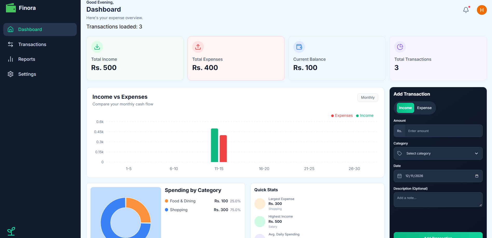
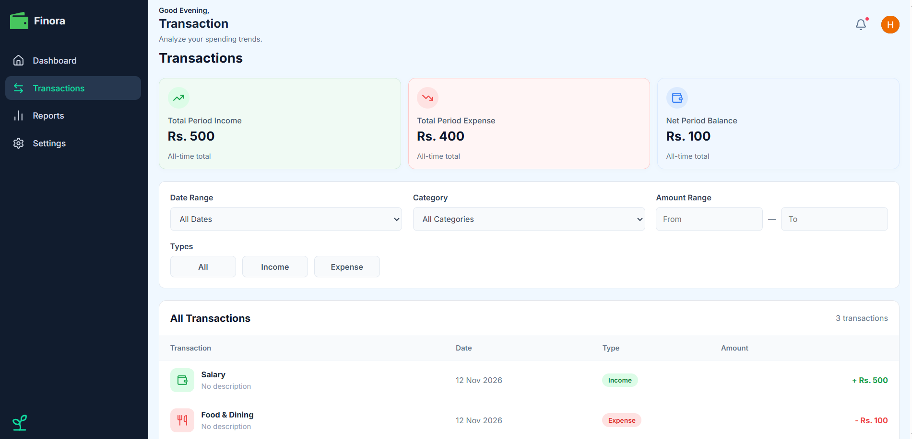
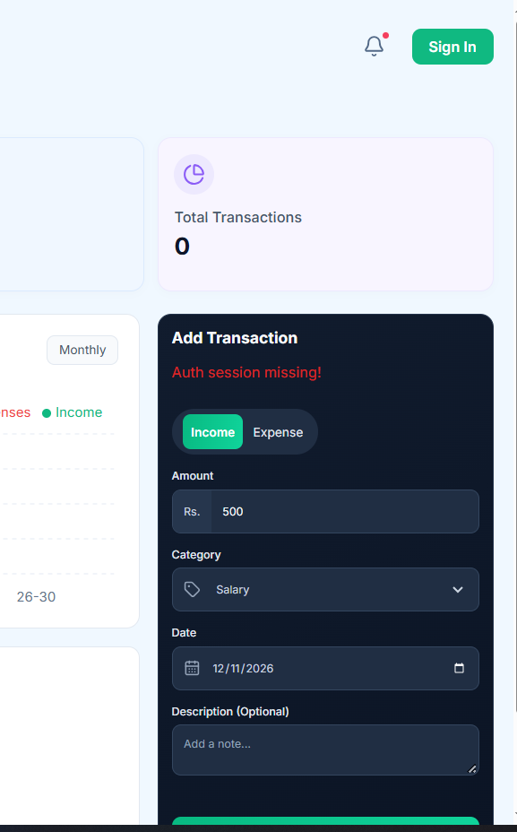
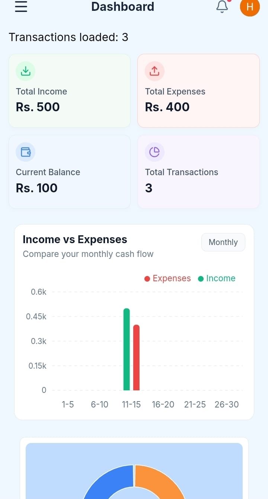

# 💸 Finora — Personal Finance Tracker

### Take control of your money. Track smarter. Spend better.

A modern, intuitive, and secure personal finance tracker designed to help you manage your income, monitor expenses, and understand your financial habits.

[🌐 Live Demo](https://finora-expenses.vercel.app/) · [📂 GitHub Repository](https://github.com/Hasnain0420/Finora)


---

## ✨ Overview

**Finora** is a web-based personal finance management application that makes tracking your money simple and organized.

Whether you're monitoring daily expenses, managing multiple income sources, or reviewing your financial activity, Finora provides a clean dashboard and an easy-to-use transaction management experience.

Built with React and powered by Supabase, Finora combines a responsive frontend with secure user authentication and cloud-based data storage.

## 🚀 Features

- 📊 **Financial Dashboard** — Get an overview of your financial activity.
- 💰 **Income Tracking** — Record and monitor your income.
- 💸 **Expense Tracking** — Keep track of where your money goes.
- 📋 **Transaction Management** — Add, view, and manage transactions.
- 🔍 **Smart Filtering** — Filter transactions by type, category, date, and amount.
- 📈 **Financial Summaries** — View total income, expenses, and net balance.
- 🔐 **Secure Authentication** — User authentication powered by Supabase, including Google OAuth.
- ☁️ **Cloud Database** — Store your financial records in Supabase.
- 🛡️ **Row-Level Security** — Protect user data with database-level access policies.
- 📱 **Responsive Interface** — Designed to work across desktop and mobile screens.

## 🖼️ Application Screenshots

### 📊 Dashboard



### 📋 Transaction Management



### 🔐 Authentication



### 📱 Mobile Experience



## 🛠️ Tech Stack

| Technology | Purpose |
|---|---|
| React | Frontend UI |
| Vite | Development and build tooling |
| JavaScript | Application logic |
| CSS | Styling and responsive layouts |
| Supabase | Backend and database |
| Supabase Auth | User authentication |
| PostgreSQL | Data storage |
| Lucide React | Icons |
| Vercel | Deployment |

## ⚙️ Getting Started

Want to run Finora locally? Follow these steps.

### 1. Clone the repository

```bash
git clone https://github.com/Hasnain0420/Finora.git
```

### 2. Navigate to the project directory

```bash
cd Finora
```

### 3. Install dependencies

```bash
npm install
```

### 4. Configure environment variables

Create a `.env` file in the root directory:

```env
VITE_SUPABASE_URL=your_supabase_project_url
VITE_SUPABASE_PUBLISHABLE_KEY=your_supabase_publishable_key
```

Add your own Supabase project credentials.

**Important:** Never commit your `.env` file or expose your Supabase service role key.

### 5. Start the development server

```bash
npm run dev
```

Open the local URL provided by Vite, usually:

```text
http://localhost:5173
```

## 🔒 Security

Finora uses Supabase authentication and Row-Level Security (RLS) policies to ensure that authenticated users can access only their own transaction records.

Environment variables containing project credentials should be configured locally and through your deployment provider rather than committed to GitHub.

## 🗺️ Project Roadmap

- [ ] Advanced financial reports and analytics
- [ ] Monthly budgets and financial goals
- [ ] Transaction export functionality
- [ ] Financial insights and notifications
- [ ] Dark mode
- [ ] Enhanced spending visualizations

## 🌐 Live Application

**[🚀 Explore Finora](https://finora-expenses.vercel.app/)**

## 👨‍💻 Author

**Muhammad Hasnain**

Software Engineering Graduate | React Developer

- GitHub: [@Hasnain0420](https://github.com/Hasnain0420)
- Project Repository: [Finora](https://github.com/Hasnain0420/Finora)

---

⭐ If you find Finora interesting, consider giving the repository a star!

**Built with ❤️ and a passion for creating useful software.**